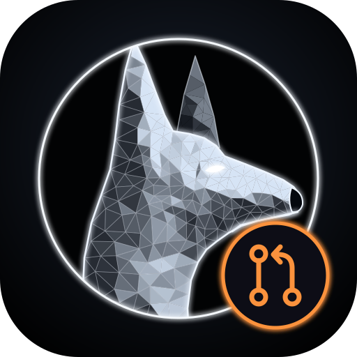

<p align="center"></p>

# Watchdog PR Review

Security review on every pull request by the [Watchdog](https://github.com/watchdoglab/watchdog) dogs. It leaves inline comments on risky lines with a fix, then one summary comment.

## Setup (2 minutes)

1. Add your AI key as a repo secret, e.g. `ANTHROPIC_API_KEY` (Settings → Secrets and variables → Actions).
   Other AIs and subscriptions are listed below.
2. Add this file as `.github/workflows/watchdog-review.yml`:

```yaml
name: Watchdog PR Review

on:
  pull_request:
    types: [opened, synchronize, ready_for_review, reopened]

permissions:
  contents: read
  pull-requests: write
  id-token: write

jobs:
  review:
    if: github.event.pull_request.draft == false
    runs-on: ubuntu-latest
    steps:
      - uses: actions/checkout@v4
        with:
          fetch-depth: 1
      - uses: watchdoglab/watchdog-action@v1
        with:
          anthropic_api_key: ${{ secrets.ANTHROPIC_API_KEY }}
          dogs: all          # or web, api, auth, ai-app, secrets, ...
          min_severity: medium
```

3. Open a PR. Watchdog comments on risky lines and posts a summary.

## Pick your AI and how you pay

Swap the `anthropic_api_key` line in the workflow for one of these. Store every key or token as a repo secret.

| AI | How you pay | Set in `with:` |
|---|---|---|
| Claude | Anthropic API key | `anthropic_api_key: ${{ secrets.ANTHROPIC_API_KEY }}` |
| Claude | Claude Pro/Max plan | `claude_code_oauth_token: ${{ secrets.CLAUDE_CODE_OAUTH_TOKEN }}` (get it with `claude setup-token`) |
| Claude | Amazon Bedrock | `provider: bedrock` + an `aws-actions/configure-aws-credentials@v4` step before |
| Claude | Google Vertex AI | `provider: vertex` + a `google-github-actions/auth@v2` step before |
| GPT, Gemini, Grok, DeepSeek, Qwen, … | OpenRouter key | `provider: openrouter`, `openrouter_api_key: ${{ secrets.OPENROUTER_API_KEY }}`, `model: openai/gpt-5` (any OpenRouter model ID) |
| OpenAI Codex | OpenAI API key | `engine: codex`, `openai_api_key: ${{ secrets.OPENAI_API_KEY }}` |
| OpenAI Codex | ChatGPT Plus/Pro plan | `engine: codex`, `codex_auth_json: ${{ secrets.CODEX_AUTH_JSON }}` — see below |
| Gemini | Gemini API key | `engine: gemini`, `gemini_api_key: ${{ secrets.GEMINI_API_KEY }}` |
| Gemini | Vertex AI | `engine: gemini`, `gemini_auth: vertex` + `gcp_workload_identity_provider`, `gcp_project_id`, `gcp_service_account` |
| Gemini | Gemini Code Assist plan | `engine: gemini`, `gemini_auth: code_assist` + the same `gcp_*` inputs |

**ChatGPT plan (advanced):** on your computer set `cli_auth_credentials_store = "file"` in `~/.codex/config.toml`, run `codex login`, and save the contents of `~/.codex/auth.json` as the `CODEX_AUTH_JSON` secret. OpenAI recommends an API key for CI, and this only suits **private repos**. The login refreshes itself, so when reviews start failing with 401, run `codex login` again and update the secret. Don't use the same secret in jobs that run at the same time.

Claude and OpenRouter load the Watchdog plugin directly. Codex and Gemini read the same Watchdog skill files and return findings that the action posts as one PR review.

Bedrock example:

```yaml
      - uses: aws-actions/configure-aws-credentials@v4
        with:
          role-to-assume: ${{ secrets.AWS_ROLE_ARN }}
          aws-region: us-east-1
      - uses: watchdoglab/watchdog-action@v1
        with:
          provider: bedrock
          model: us.anthropic.claude-sonnet-5-5-v1:0
```

## Inputs

| Input | Default | What it does |
|---|---|---|
| `engine` | `claude` | `claude`, `codex` or `gemini`. |
| `dogs` | `all` | Which review: `all`, `web`, `api`, `auth`, `ai-app`, `secrets`, … |
| `min_severity` | `medium` | Skip findings below this. |
| `model` | engine default | Model ID for your provider. |
| `provider` | `anthropic` | Claude only: `anthropic`, `bedrock`, `vertex` or `openrouter`. |
| `anthropic_api_key`, `claude_code_oauth_token`, `openrouter_api_key` | — | Claude engine sign-in. |
| `openai_api_key`, `codex_auth_json` | — | Codex engine sign-in. |
| `gemini_api_key`, `gemini_auth`, `gcp_*` | — / `api_key` | Gemini engine sign-in. |

## Safety

- Uses `pull_request` (not `pull_request_target`), so PRs from forks never see your secrets.
- The reviewer can only read code and post comments. It cannot push or run project code. Codex runs in a read-only sandbox and Gemini gets read-only tools.
- The `codex` engine removes `sudo` from the runner for the rest of the job (OpenAI's default safety setting), so run it as the last step.
- PR text is treated as untrusted input, never as instructions.
